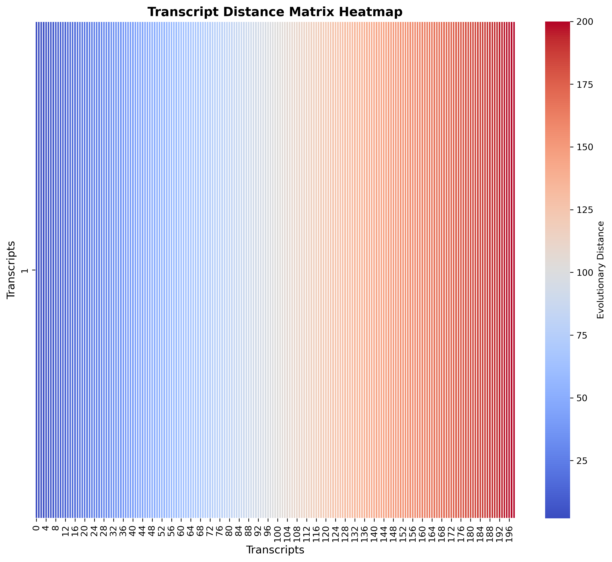

#Transcript Distance Matrix Heatmap

## 📊 Heatmap Visualization (`results/distance_heatmap.png` / `similarity_heatmap.png`)

## 🚀 Project Summary & Workflow
This section documents the distance matrix and heatmap analysis for our transcript dataset:

1. **Dataset Overview:** 
   - Analyzed **200 transcripts** (`data/transcripts_200.fa`) to evaluate sequence divergence and evolutionary relationships[cite: 1].
2. **Multiple Sequence Alignment (MSA):** 
   - Aligned sequences using command-line **MAFFT** (`--globalpair --maxiterate 1000`) adopting the G-INS-i strategy for high-accuracy global alignment.
3. **Distance Matrix Generation:** 
   - Calculated pairwise evolutionary distances using **EMBOSS distmat** in lower triangular format.
4. **Heatmap Interpretation:** 
   - The generated heatmap visualizes the pairwise evolutionary distances among the 200 transcripts[cite: 1]. 
   - **Color Scale:** The color gradient ranges from **blue (low distance / high similarity)** to **red (high evolutionary distance up to 200)**[cite: 1].

## 📁 Output Files
- **Aligned Sequences:** `results/aligned.fa`
- **Distance Matrix:** `results/distances.txt`
- **Heatmap Visualization:** `results/similarity_heatmap.png`
