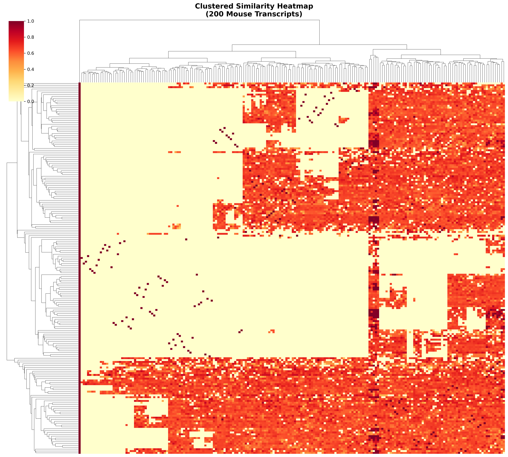
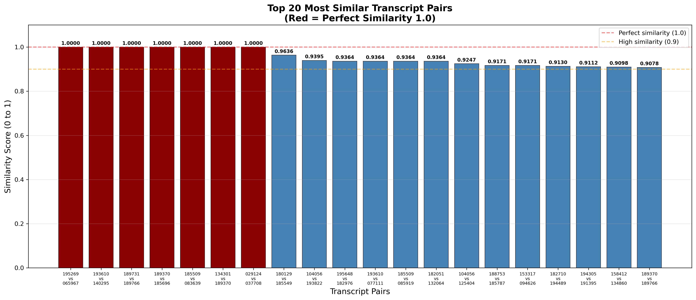
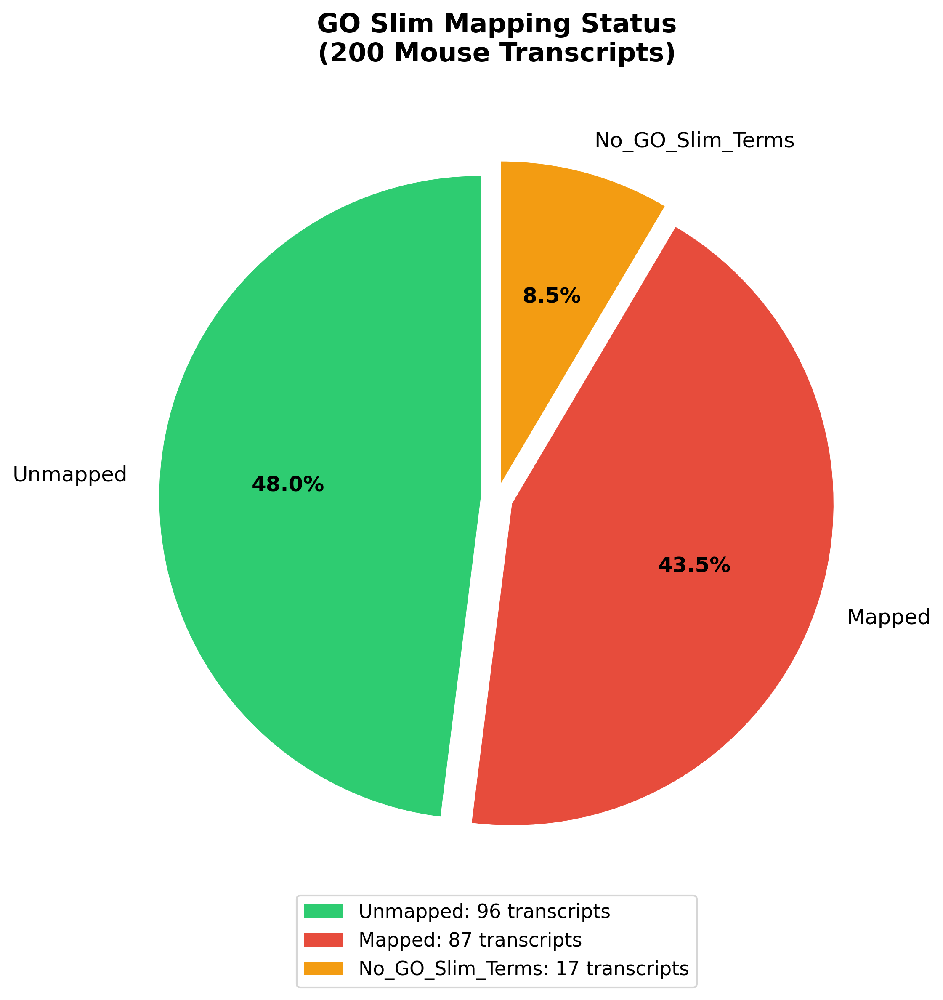
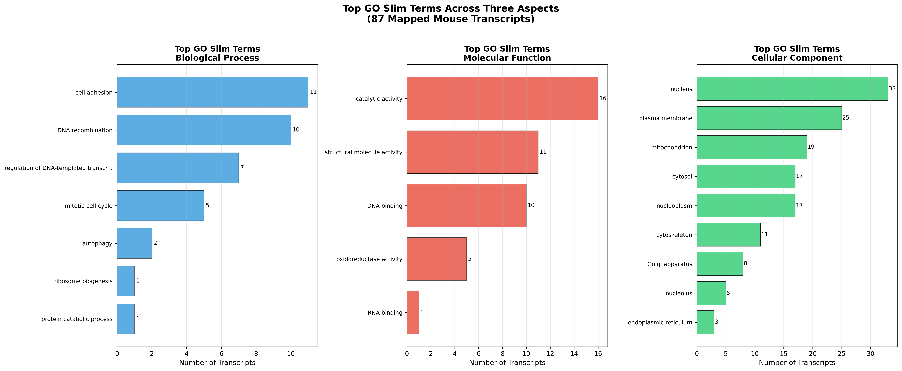

# Transcript Evolutionary Distance, Similarity & GO Slim Analysis

## Project Overview
| Parameter | Details |
|---|---|
| Organism | Mus musculus (Mouse) |
| Dataset | 200 transcripts |
| Pipeline | MSA to Distance to Similarity to GO Slim |

---

# Task 1 - MSA and Distance Matrix

## Tools Used
| Tool | Purpose |
|---|---|
| MAFFT | Multiple Sequence Alignment (G-INS-i) |
| EMBOSS distmat | Evolutionary Distance (Jukes-Cantor) |

## Results
| Parameter | Value |
|---|---|
| Total Transcripts | 200 |
| Alignment Length | 23,150 bp |
| Matrix Shape | 200 x 200 |
| Max Distance | 477.87 |
| Min Distance | 0.03 |
| Mean Distance | 165.46 |

## Visualizations

### 1. Distance Heatmap

### 2. Similarity Heatmap

### 3. Clustered Heatmap

---

# Task 2 - Maximum Similarity Analysis

## Key Results
| Metric | Value |
|---|---|
| Total Pairs | 19,900 |
| Perfect Pairs (1.0) | 7 |
| High Similarity (>0.7) | 1,734 |
| Medium (0.4-0.7) | 6,991 |
| Low (<0.4) | 11,175 |
| Mean Similarity | 0.2861 |

## Top 7 Perfect Pairs
| Rank | Transcript A | Transcript B | Score |
|---|---|---|---|
| 1 | ENSMUST00000195269.2 | ENSMUST00000065967.14 | 1.0 |
| 2 | ENSMUST00000193610.2 | ENSMUST00000140295.8 | 1.0 |
| 3 | ENSMUST00000189731.2 | ENSMUST00000189766.2 | 1.0 |
| 4 | ENSMUST00000189370.2 | ENSMUST00000185696.2 | 1.0 |
| 5 | ENSMUST00000185509.2 | ENSMUST00000083639.3 | 1.0 |
| 6 | ENSMUST00000134301.2 | ENSMUST00000189370.2 | 1.0 |
| 7 | ENSMUST00000029124.8 | ENSMUST00000037708.10 | 1.0 |

## Visualizations

### 4. Top 20 Similar Pairs

### 5. Similarity Distribution

### 6. Perfect Pairs Heatmap

---

# Task 3 - GO Slim Functional Annotation

## Annotation Sources
| Source | File | Version |
|---|---|---|
| Mouse GO Annotations | mgi.gaf.gz | May 2026 |
| GO Slim Terms | goslim_generic.obo | July 2026 |
| GO Slim Tool | goatools v1.6.9 | Python library |

## Key Results
| Metric | Value |
|---|---|
| Total Transcripts | 200 |
| Successfully Mapped | 87 (43.5%) |
| Unmapped | 96 (48.0%) |
| No GO Slim Terms | 17 (8.5%) |
| GO Slim Terms Loaded | 206 |
| Detail Records | 218 |

## Annotation Coverage per Aspect
| Aspect | Question | Transcripts Annotated | Top Term |
|---|---|---|---|
| Biological Process (BP) | What biological goal? | 32 | cell adhesion |
| Molecular Function (MF) | What molecular activity? | 33 | catalytic activity |
| Cellular Component (CC) | Where in the cell? | 85 | nucleus |

## Why Some Are Unmapped?
Most unmapped transcripts are Gm genes (predicted gene models).
These are computationally predicted genes not yet fully characterized.
They lack GO annotations in current databases.
All transcripts including unmapped are retained in output as required.

## Output Files
| File | Contents |
|---|---|
| results/transcript_go_slim.tsv | Main output: transcript ID, gene ID, MF, BP, CC terms, mapping status |
| results/transcript_go_detail.tsv | Detailed table with evidence codes |

## Visualizations

### 7. Mapping Status

### 8. Top GO Slim Terms

### 9. Aspect Coverage

---

# Key Files
| File | Description |
|---|---|
| data/transcripts_200.fa | 200 mouse transcripts (input) |
| results/aligned.fa | MAFFT aligned sequences |
| results/distances.txt | Pairwise distances |
| results/similarity_matrix_FIXED.txt | Similarity scores 0 to 1 |
| results/transcript_go_slim.tsv | GO Slim annotation output |
| results/transcript_go_detail.tsv | GO annotation with evidence codes |
| data/go_annotations/mgi.gaf.gz | Mouse GO annotation source |
| data/go_annotations/goslim_generic.obo | GO Slim terms file |

# Scripts
| Script | Purpose |
|---|---|
| fix_heatmap.py | Task 1 and 2: Parse distances, generate heatmaps |
| task2_analysis.py | Task 2: Find maximum similar pairs |
| go_slim_mapping.py | Task 3: GO Slim annotation pipeline |
| task3_graphs.py | Task 3: Generate GO Slim graphs |

# Biological Conclusions

## Task 1
- 200 transcripts aligned to 23,150 bp
- Mean similarity = 28.6%
- Sequences form distinct evolutionary clusters

## Task 2
- 7 perfect pairs found (likely isoforms or duplicates)
- 56% of pairs show low similarity
- Most transcripts from different gene families

## Task 3
- 87 transcripts successfully annotated (43.5%)
- Most proteins located in nucleus (CC)
- Most common function is catalytic activity (MF)
- Most common process is cell adhesion (BP)
- 96 unmapped = predicted Gm genes not yet in GO database
---

# Task 4 - Enrichment Analysis on 5 Clusters

## Goal
Divide 200 transcripts into 5 clusters based on
sequence similarity and find which GO Slim functions
are enriched in each cluster.

## Cluster Results
| Cluster | Size | Mapped | Top BP | Top MF | Top CC |
|---|---|---|---|---|---|
| Cluster 1 | 89 | 36 | cell adhesion | catalytic activity | plasma membrane |
| Cluster 2 | 46 | 16 | cell adhesion | structural molecule | nucleus |
| Cluster 3 | 17 | 12 | transcription regulation | not found | cytosol |
| Cluster 4 | 27 | 13 | transcription regulation | oxidoreductase | nucleus |
| Cluster 5 | 21 | 10 | DNA recombination | structural molecule | cytosol |

## Biological Meaning
| Cluster | Biological Role |
|---|---|
| Cluster 1 | Surface proteins doing cell adhesion |
| Cluster 2 | Nuclear structural proteins |
| Cluster 3 | Gene regulators in cytosol |
| Cluster 4 | Nuclear enzymes doing redox reactions |
| Cluster 5 | DNA editors doing recombination |

## Visualizations

### 10. Cluster Sizes

### 11. GO Coverage per Cluster

### 12. Top Functions per Cluster

---

# Task 5 - GTEx Co-expression Analysis
Coming soon...

---

# Biological Conclusions

## Task 1
- 200 transcripts aligned to 23,150 bp
- Mean similarity = 28.6%
- Sequences form distinct evolutionary clusters

## Task 2
- 7 perfect pairs found (isoforms or duplicates)
- 56% of pairs show low similarity
- Most transcripts from different gene families

## Task 3
- 87 transcripts successfully annotated (43.5%)
- Most proteins located in nucleus
- Most common function is catalytic activity
- Most common process is cell adhesion

## Task 4
- 5 clusters identified from similarity matrix
- Each cluster has distinct biological function
- Confirms: similar sequences = similar function
- Cluster 1 (biggest) = surface membrane proteins
- Cluster 3 (best mapped) = gene regulators
