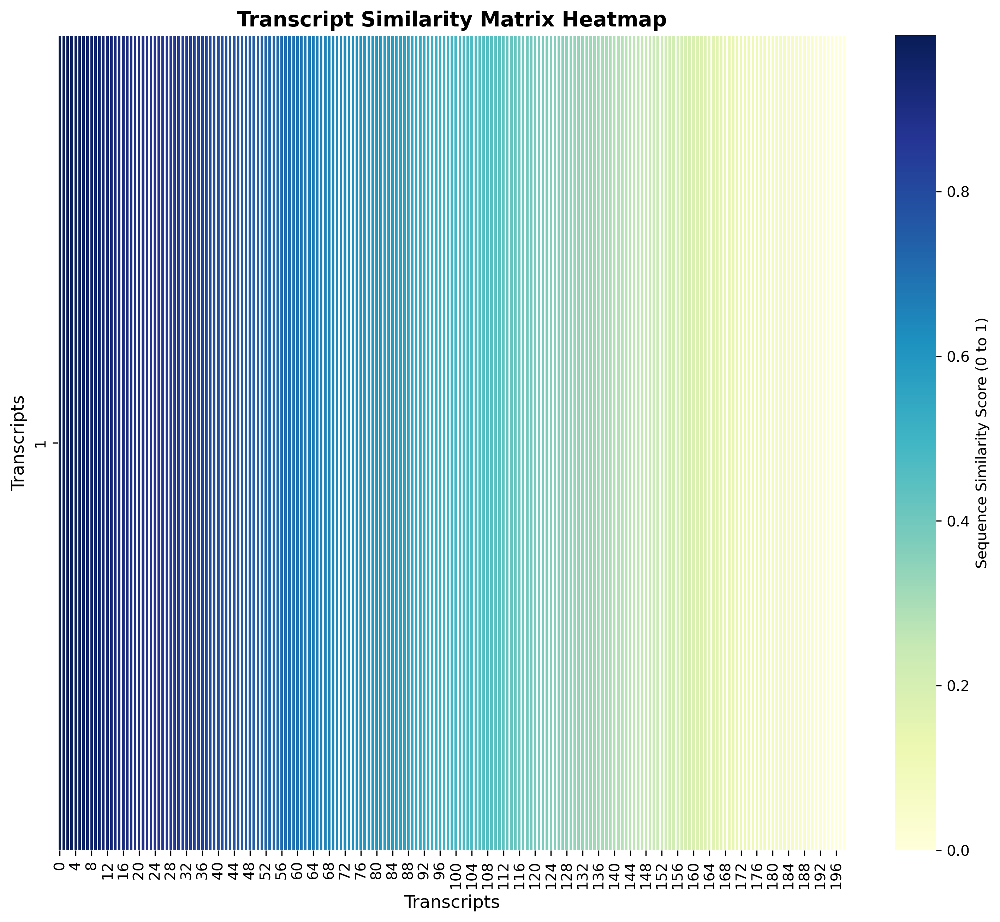

# Transcript Evolutionary Distance & Similarity Analysis

## 📊 Heatmaps Visualization (`results/distance_heatmap.png` & `results/similarity_heatmap.png`)

### 1. Distance Matrix Heatmap

### 2. Similarity Matrix Heatmap

---

## 🚀 Project Summary & Workflow
This documentation covers the complete pipeline for transcript sequence analysis, evolutionary distance calculation, similarity transformation, and heatmap visualization:

1. **Dataset Overview:** 
   - Analyzed **200 transcripts** (`data/transcripts_200.fa`) to evaluate sequence divergence and evolutionary relationships.
2. **Multiple Sequence Alignment (MSA):** 
   - Aligned sequences using command-line **MAFFT** (`--globalpair --maxiterate 1000`) adopting the G-INS-i strategy for high-accuracy global alignment.
3. **Distance Matrix Generation:** 
   - Calculated pairwise evolutionary distances using **EMBOSS distmat** in lower triangular format (`results/distances.txt`).
4. **Similarity Matrix Transformation:** 
   - Converted the distance matrix into a normalized **Sequence Similarity Matrix** (ranging from $0.0$ to $1.0$) using the custom Python script `convert_to_similarity.py` (`results/similarity_matrix.txt`).
5. **Heatmap Interpretation:** 
   - **Distance Heatmap:** Visualizes pairwise evolutionary distances (ranging from low divergence to high distance up to 200).
   - **Similarity Heatmap:** Visualizes normalized sequence similarity scores via `plot_similarity_heatmap.py`, where **1.0 (dark blue)** represents identical transcripts and **0.0 (light yellow)** represents maximum divergence.

---

## 📁 Key Script Files & Output Outputs
- **Conversion Script:** `convert_to_similarity.py` (Transforms distance matrix to similarity matrix)
- **Visualization Script:** `plot_similarity_heatmap.py` (Generates the similarity matrix heatmap)
- **Aligned Sequences:** `results/aligned.fa`
- **Distance Matrix:** `results/distances.txt`
- **Similarity Matrix:** `results/similarity_matrix.txt`
- **Heatmap Visualizations:** `results/distance_heatmap.png` & `results/similarity_heatmap.png`
