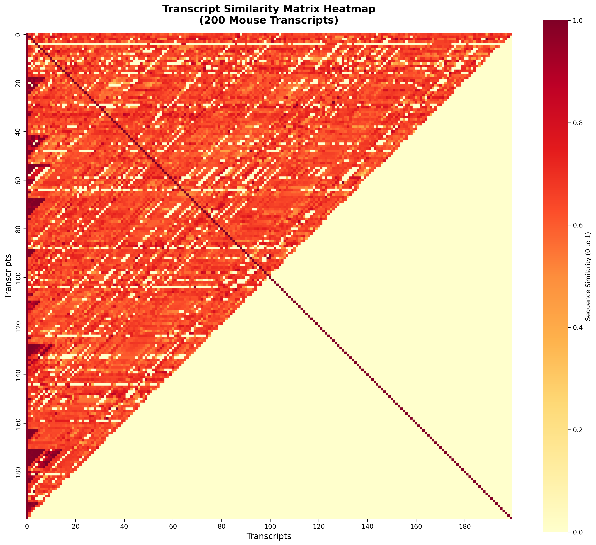
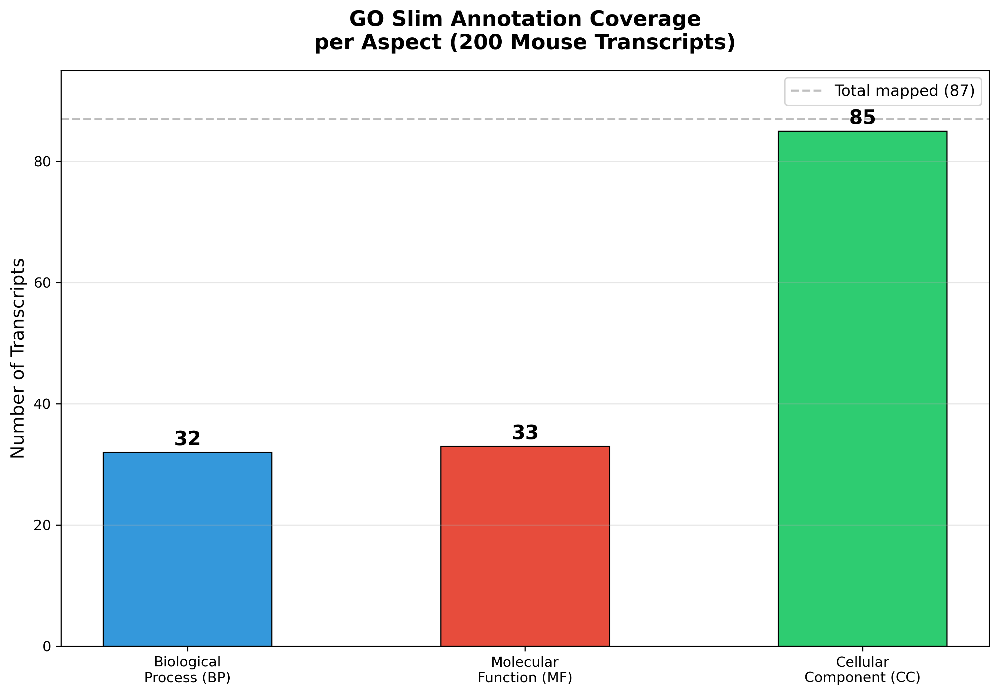
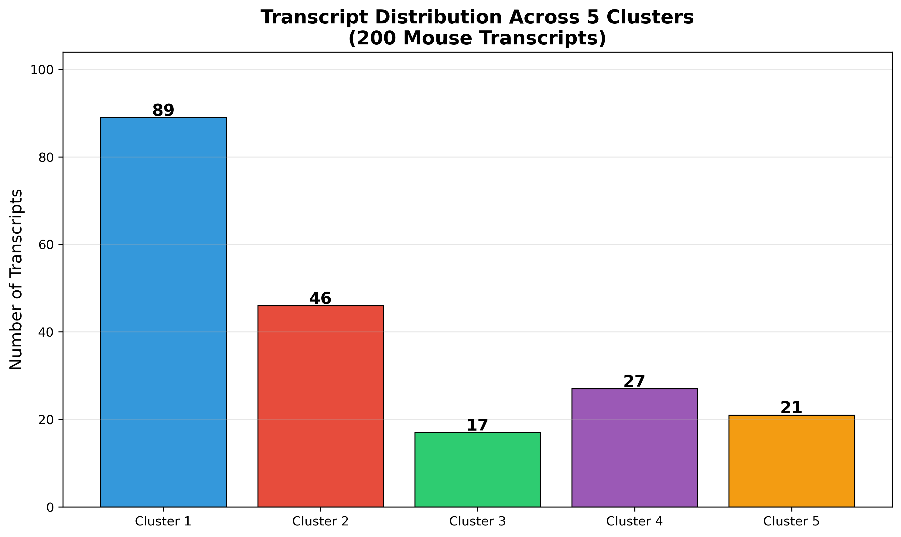
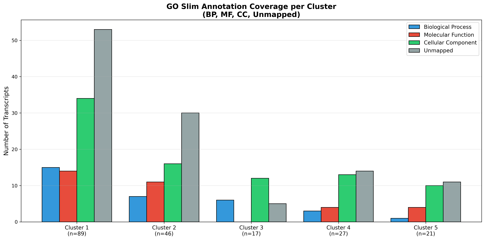
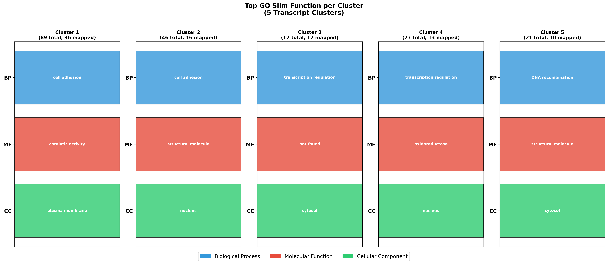
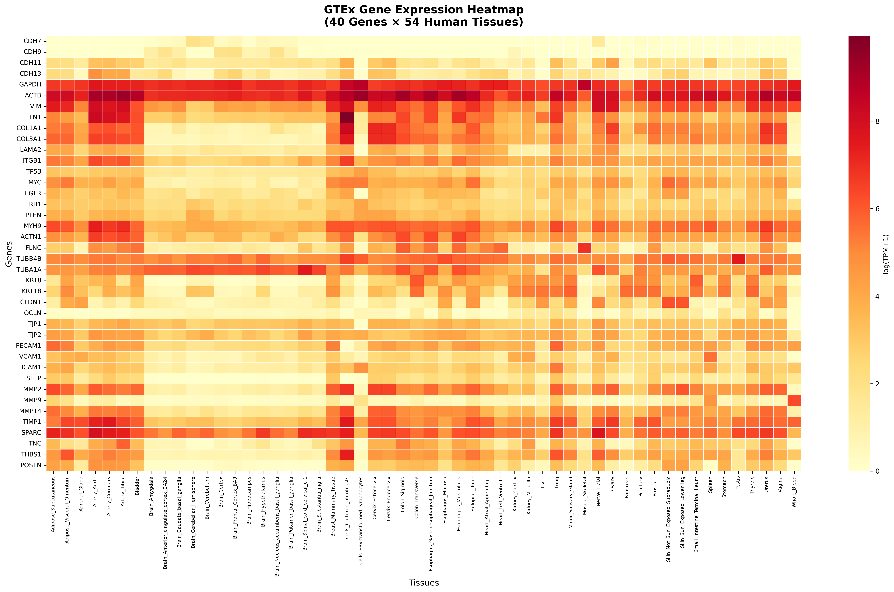
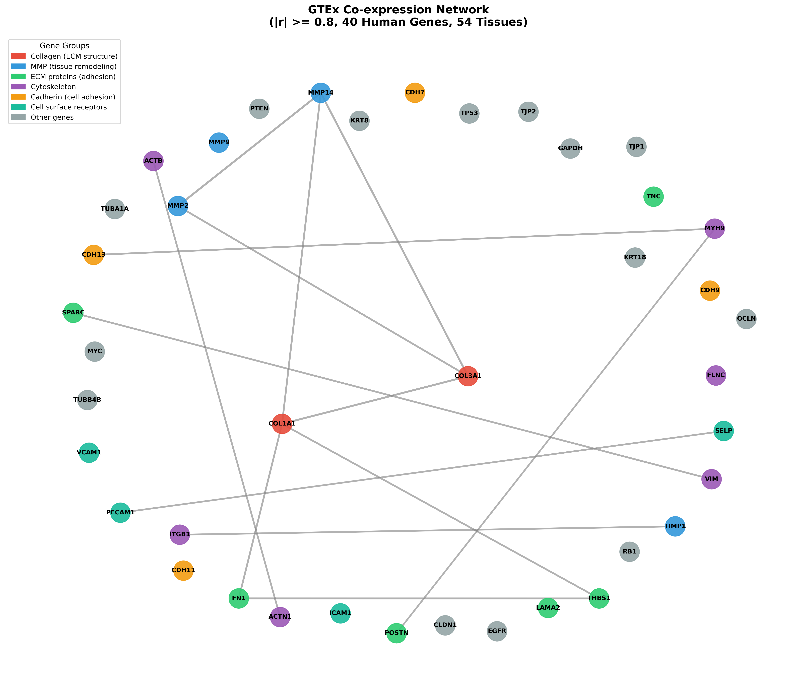
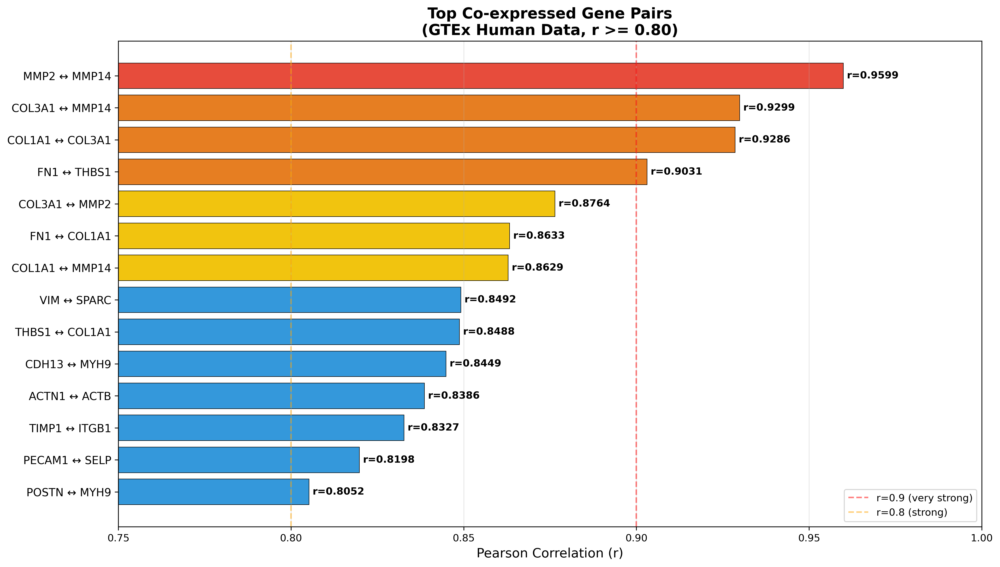
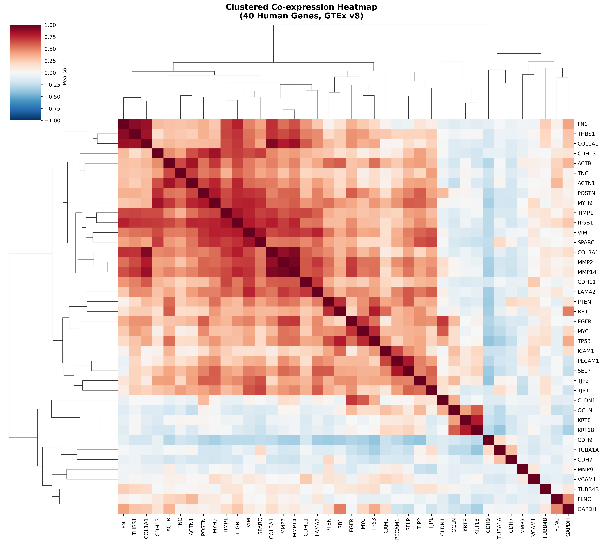

# Transcript Analysis Project

## Project Overview
| Parameter | Details |
|---|---|
| Organism | Mus musculus (Mouse) |
| Dataset | 200 transcripts |
| Pipeline | MSA to Distance to Similarity to GO Slim to Enrichment to Co-expression |

---

# Task 1 - MSA and Distance Matrix

## Tools Used
| Tool | Purpose |
|---|---|
| MAFFT | Multiple Sequence Alignment (G-INS-i) |
| EMBOSS distmat | Evolutionary Distance (Jukes-Cantor) |

## Results
| Parameter | Value |
|---|---|
| Total Transcripts | 200 |
| Alignment Length | 23,150 bp |
| Matrix Shape | 200 x 200 |
| Max Distance | 477.87 |
| Min Distance | 0.03 |
| Mean Distance | 165.46 |

## Visualizations

### 1. Distance Heatmap

### 2. Similarity Heatmap

### 3. Clustered Heatmap

---

# Task 2 - Maximum Similarity Analysis

## Key Results
| Metric | Value |
|---|---|
| Total Pairs | 19,900 |
| Perfect Pairs (1.0) | 7 |
| High Similarity (>0.7) | 1,734 |
| Medium (0.4-0.7) | 6,991 |
| Low (<0.4) | 11,175 |
| Mean Similarity | 0.2861 |

## Top 7 Perfect Pairs
| Rank | Transcript A | Transcript B | Score |
|---|---|---|---|
| 1 | ENSMUST00000195269.2 | ENSMUST00000065967.14 | 1.0 |
| 2 | ENSMUST00000193610.2 | ENSMUST00000140295.8 | 1.0 |
| 3 | ENSMUST00000189731.2 | ENSMUST00000189766.2 | 1.0 |
| 4 | ENSMUST00000189370.2 | ENSMUST00000185696.2 | 1.0 |
| 5 | ENSMUST00000185509.2 | ENSMUST00000083639.3 | 1.0 |
| 6 | ENSMUST00000134301.2 | ENSMUST00000189370.2 | 1.0 |
| 7 | ENSMUST00000029124.8 | ENSMUST00000037708.10 | 1.0 |

## Visualizations

### 4. Top 20 Similar Pairs

### 5. Similarity Distribution

### 6. Perfect Pairs Heatmap

---

# Task 3 - GO Slim Functional Annotation

## Annotation Sources
| Source | File | Version |
|---|---|---|
| Mouse GO Annotations | mgi.gaf.gz | May 2026 |
| GO Slim Terms | goslim_generic.obo | July 2026 |
| GO Slim Tool | goatools v1.6.9 | Python library |

## Key Results
| Metric | Value |
|---|---|
| Total Transcripts | 200 |
| Successfully Mapped | 87 (43.5%) |
| Unmapped | 96 (48.0%) |
| No GO Slim Terms | 17 (8.5%) |
| GO Slim Terms Loaded | 206 |

## Annotation Coverage
| Aspect | Transcripts | Top Term |
|---|---|---|
| Biological Process (BP) | 32 | cell adhesion |
| Molecular Function (MF) | 33 | catalytic activity |
| Cellular Component (CC) | 85 | nucleus |

## Visualizations

### 7. Mapping Status

### 8. Top GO Slim Terms

### 9. Aspect Coverage

---

# Task 4 - Enrichment Analysis on 5 Clusters

## Cluster Results
| Cluster | Size | Mapped | Top BP | Top MF | Top CC |
|---|---|---|---|---|---|
| Cluster 1 | 89 | 36 | cell adhesion | catalytic activity | plasma membrane |
| Cluster 2 | 46 | 16 | cell adhesion | structural molecule | nucleus |
| Cluster 3 | 17 | 12 | transcription regulation | not found | cytosol |
| Cluster 4 | 27 | 13 | transcription regulation | oxidoreductase | nucleus |
| Cluster 5 | 21 | 10 | DNA recombination | structural molecule | cytosol |

## Biological Meaning
| Cluster | Biological Role |
|---|---|
| Cluster 1 | Surface proteins doing cell adhesion |
| Cluster 2 | Nuclear structural proteins |
| Cluster 3 | Gene regulators in cytosol |
| Cluster 4 | Nuclear enzymes doing redox reactions |
| Cluster 5 | DNA editors doing recombination |

## Visualizations

### 10. Cluster Sizes

### 11. GO Coverage per Cluster

### 12. Top Functions per Cluster

---

# Task 5 - GTEx Co-expression Analysis

## Data Source
| Parameter | Details |
|---|---|
| Database | GTEx v8 (Genotype Tissue Expression) |
| Genes | 40 human genes (orthologs of mouse transcripts) |
| Tissues | 54 human body tissues |
| Correlation threshold | Pearson r >= 0.8 |
| Variable gene threshold | CV > 0.5 |

## Key Results
| Metric | Value |
|---|---|
| Total genes | 40 |
| Tissues analyzed | 54 |
| Variable genes | 40 (all variable) |
| Co-expressed pairs (r>=0.8) | 14 |
| Strongest pair | MMP2 and MMP14 (r=0.9599) |

## Top Co-expressed Pairs
| Rank | Gene A | Gene B | Correlation | Biology |
|---|---|---|---|---|
| 1 | MMP2 | MMP14 | 0.9599 | Tissue remodeling enzymes |
| 2 | COL3A1 | MMP14 | 0.9299 | Collagen and its enzyme |
| 3 | COL1A1 | COL3A1 | 0.9286 | Collagen types together |
| 4 | FN1 | THBS1 | 0.9031 | ECM adhesion proteins |
| 5 | COL3A1 | MMP2 | 0.8764 | Tissue remodeling |

## Co-expression Groups
| Group | Genes | Function |
|---|---|---|
| ECM Structure | COL1A1 COL3A1 FN1 THBS1 | Building tissue |
| Tissue Remodeling | MMP2 MMP14 COL3A1 | Breaking down tissue |
| Cell Adhesion | PECAM1 SELP CDH13 ITGB1 | Cell attachment |

## Visualizations

### 13. Expression Heatmap

### 14. Co-expression Network

### 15. Top Co-expressed Pairs

### 16. Correlation Heatmap (Clustered)

---

# Key Files
| File | Description |
|---|---|
| data/transcripts_200.fa | 200 mouse transcripts |
| results/aligned.fa | MAFFT aligned sequences |
| results/distances.txt | Pairwise distances |
| results/similarity_matrix_FIXED.txt | Similarity scores |
| results/transcript_go_slim.tsv | GO Slim annotations |
| results/cluster_assignments.tsv | 5 cluster assignments |
| data/gtex/gtex_expression_matrix.tsv | GTEx expression data |
| results/coexpressed_pairs.tsv | Co-expressed gene pairs |

# Scripts
| Script | Purpose |
|---|---|
| fix_heatmap.py | Task 1 and 2: Heatmap generation |
| task2_analysis.py | Task 2: Similarity pair analysis |
| go_slim_mapping.py | Task 3: GO Slim annotation |
| task3_graphs.py | Task 3: GO Slim graphs |
| task3_graphs.py | Task 4: Enrichment analysis |
| go_slim_mapping.py | Task 5: GTEx co-expression |

# Biological Conclusions

## Task 1
- 200 transcripts aligned to 23,150 bp
- Mean similarity = 28.6%
- Sequences form distinct evolutionary clusters

## Task 2
- 7 perfect pairs found (isoforms or duplicates)
- 56% of pairs show low similarity
- Most transcripts from different gene families

## Task 3
- 87 transcripts annotated (43.5%)
- Top location: nucleus
- Top function: catalytic activity
- Top process: cell adhesion

## Task 4
- 5 clusters with distinct biological functions
- Confirms: similar sequences = similar function
- Cluster 1 = surface membrane proteins

## Task 5
- 14 co-expressed pairs found in human GTEx data
- Strongest: MMP2 and MMP14 (r=0.9599)
- 3 main groups: ECM structure, remodeling, adhesion
- Human data confirms mouse cell adhesion findings
- Mouse and human gene function is conserved!
