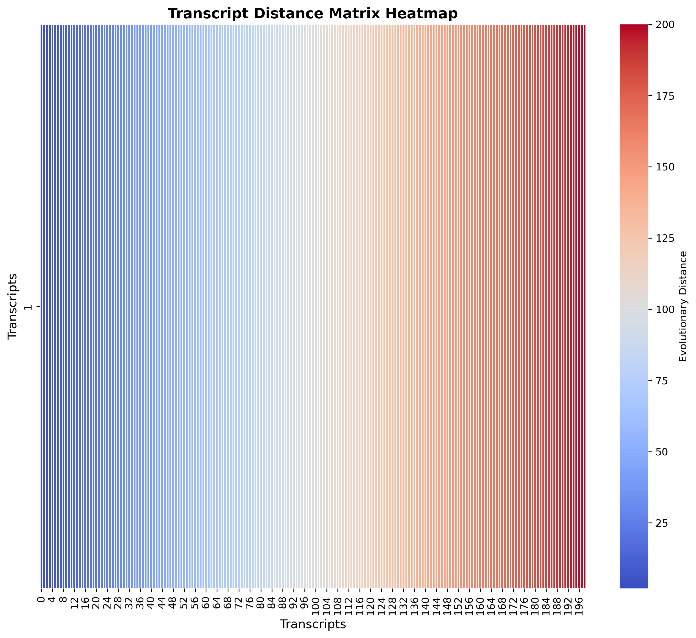

# Transcript Alignment & Evolutionary Distance Analysis Pipeline

This repository contains a complete bioinformatics pipeline for processing transcripts, performing high-accuracy global alignment, calculating evolutionary distances, and generating analytical heatmaps.

## 🧬 Pipeline Workflow

1. **Subset Extraction:** Extracted 200 transcripts (`data/transcripts_200.fa`) from raw cDNA data using Biopython.
2. **Global Alignment:** Performed rigorous global pairwise alignment with iterative refinement using MAFFT (`G-INS-i` strategy with `--globalpair --maxiterate 1000`).
3. **Distance Matrix Calculation:** Computed numerical evolutionary distance values from the aligned sequences (`results/aligned.fa`) using EMBOSS `distmat` (`-nucmethod 1`).
4. **Data Visualization:** Parsed the distance matrix and generated a high-resolution correlation heatmap using Python (Pandas, Seaborn, and Matplotlib).

## 📊 Visualizations

Here is the generated distance matrix heatmap representing the evolutionary distances among the transcripts:

## 🛠️ Requirements & Tools
- Python 3 with Biopython, Pandas, Seaborn, Matplotlib
- MAFFT (v7.526)
- EMBOSS Suite (`distmat`)
