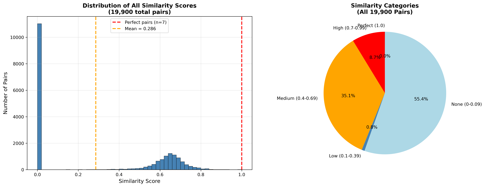
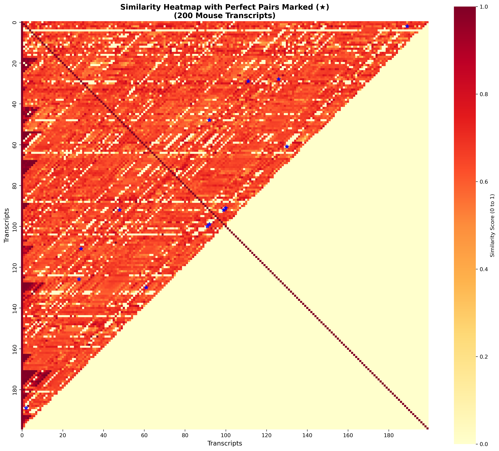

# Transcript Analysis Project

## Project Overview
- Organism: Mus musculus (Mouse)
- Dataset: 200 transcripts
- Pipeline: MSA → Distance → Similarity → GO Slim

---

# Task 1 - MSA and Distance Matrix

## Tools Used
- MAFFT: Multiple Sequence Alignment
- EMBOSS distmat: Jukes-Cantor correction

## Results
| Parameter | Value |
|---|---|
| Total Transcripts | 200 |
| Alignment Length | 23,150 bp |
| Matrix Shape | 200 x 200 |
| Max Distance | 477.87 |
| Min Distance | 0.03 |
| Mean Distance | 165.46 |

## Visualizations

### 1. Distance Heatmap

### 2. Similarity Heatmap

### 3. Clustered Heatmap

---

# Task 2 - Maximum Similarity Analysis

## Key Results
| Metric | Value |
|---|---|
| Total Pairs | 19,900 |
| Perfect Pairs (1.0) | 7 |
| High Similarity (>0.7) | 1,734 |
| Medium (0.4-0.7) | 6,991 |
| Low (<0.4) | 11,175 |
| Mean Similarity | 0.2861 |

## Top 7 Perfect Pairs
| Rank | Transcript A | Transcript B | Score |
|---|---|---|---|
| 1 | ENSMUST00000195269.2 | ENSMUST00000065967.14 | 1.0 |
| 2 | ENSMUST00000193610.2 | ENSMUST00000140295.8 | 1.0 |
| 3 | ENSMUST00000189731.2 | ENSMUST00000189766.2 | 1.0 |
| 4 | ENSMUST00000189370.2 | ENSMUST00000185696.2 | 1.0 |
| 5 | ENSMUST00000185509.2 | ENSMUST00000083639.3 | 1.0 |
| 6 | ENSMUST00000134301.2 | ENSMUST00000189370.2 | 1.0 |
| 7 | ENSMUST00000029124.8 | ENSMUST00000037708.10 | 1.0 |

## Visualizations

### 4. Top 20 Similar Pairs

### 5. Similarity Distribution

### 6. Perfect Pairs Heatmap

---

# Task 3 - GO Slim Annotation
Coming soon...

---

# Key Files
| File | Description |
|---|---|
| data/transcripts_200.fa | 200 mouse transcripts |
| results/aligned.fa | MAFFT aligned sequences |
| results/distances.txt | Pairwise distances |
| results/similarity_matrix_FIXED.txt | Similarity scores |
| results/distance_heatmap_FIXED.png | Task 1 distance heatmap |
| results/similarity_heatmap_FIXED.png | Task 1 similarity heatmap |
| results/clustered_similarity_heatmap_FIXED.png | Task 1 clustered |
| results/top20_similar_pairs.png | Task 2 top 20 pairs |
| results/similarity_distribution.png | Task 2 distribution |
| results/similarity_perfect_pairs.png | Task 2 perfect pairs |
| results/goslim_extracted_report.tsv | Task 3 GO Slim |

---

# Biological Conclusions

## Task 1
- 200 transcripts aligned to 23,150 bp
- Mean similarity = 28.6%
- Sequences form distinct evolutionary clusters

## Task 2
- 7 perfect pairs found (isoforms or duplicates)
- 56% of pairs show low similarity
- 8.7% show high similarity
- Most transcripts from different gene families

## Task 3
- GO Slim annotation coming soon
