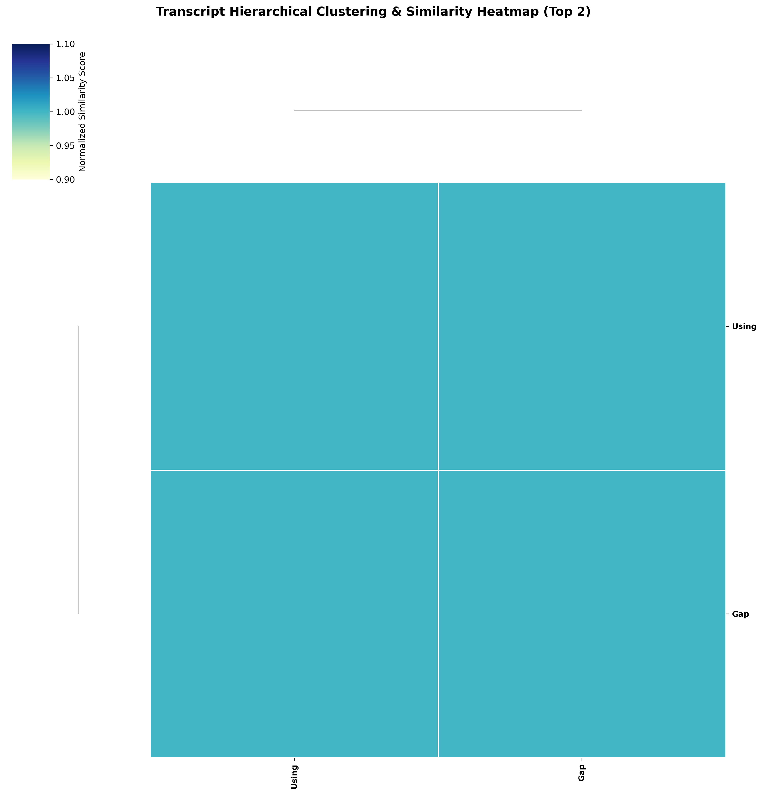

kk# Bioinformatics Project: Transcript Hierarchical Clustering

## 📊 Clustered Similarity Heatmap

## 🚀 Project Summary & Workflow
This repository contains the computational pipeline for transcript sequence analysis:
1. **Multiple Sequence Alignment:** Aligned transcripts using command-line **MAFFT** (global-pair settings).
2. **Distance Matrix:** Computed pairwise distances using **EMBOSS distmat** (Lower Triangular format).
3. **Data Parsing & Normalization:** Processed via custom Python scripts to handle formatting and convert raw distances into normalized similarity scores ($0 \text{ to } 1$).
4. **Hierarchical Clustering:** Performed clustering using **Scipy** (`sch.linkage`) and visualized high-resolution heatmaps with **Seaborn** (`clustermap`).

## 📁 Results
- **Distance Matrix:** `results/distances.txt`
- **Heatmap Visualization:** `results/clustered_similarity_heatmap.png`
