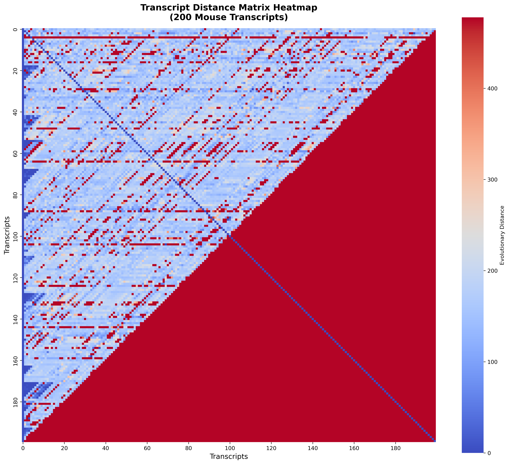

# Transcript Evolutionary Distance, Similarity & GO Slim Functional Analysis

## 🧬 Project Overview
- **Organism:** Mus musculus (Mouse)
- **Dataset:** 200 transcripts (`data/transcripts_200.fa`)
- **Analysis:** MSA → Distance Matrix → Similarity Matrix → GO Slim Annotation

---

## 📊 Task 1 — Multiple Sequence Alignment & Distance Analysis

### Tools Used:
- **MAFFT** (G-INS-i strategy): `--globalpair --maxiterate 1000`
- **EMBOSS distmat** (Jukes-Cantor correction method)

### Results:
| Parameter | Value |
|---|---|
| Total Transcripts | 200 |
| Alignment Length | 23,150 bp |
| Matrix Shape | 200 × 200 |
| Max Distance | 477.87 |
| Min Distance | 0.03 |
| Mean Distance | 165.46 |
| Mean Similarity | 0.296 (29.6%) |

---

## 📈 Visualizations

### 1. Distance Matrix Heatmap

### 2. Similarity Matrix Heatmap

### 3. Clustered Similarity Heatmap

---

## 📁 Key Files
| File | Description |
|---|---|
| `data/transcripts_200.fa` | 200 mouse transcripts (input) |
| `results/aligned.fa` | MAFFT aligned sequences |
| `results/distances.txt` | Pairwise evolutionary distances |
| `results/similarity_matrix_FIXED.txt` | Normalized similarity (0 to 1) |
| `results/distance_heatmap_FIXED.png` | Distance visualization |
| `results/similarity_heatmap_FIXED.png` | Similarity visualization |
| `results/clustered_similarity_heatmap_FIXED.png` | Clustered visualization |
| `results/goslim_extracted_report.tsv` | GO Slim functional annotation |
| `fix_heatmap.py` | Script to generate heatmaps |

---

## 🛠️ Scripts
- `fix_heatmap.py` — Reads distances.txt, converts to similarity, generates all 3 heatmaps
- `extract_goslim_info.py` — GO Slim extraction
- `run_goslim_extraction.py` — GO Slim pipeline runner

