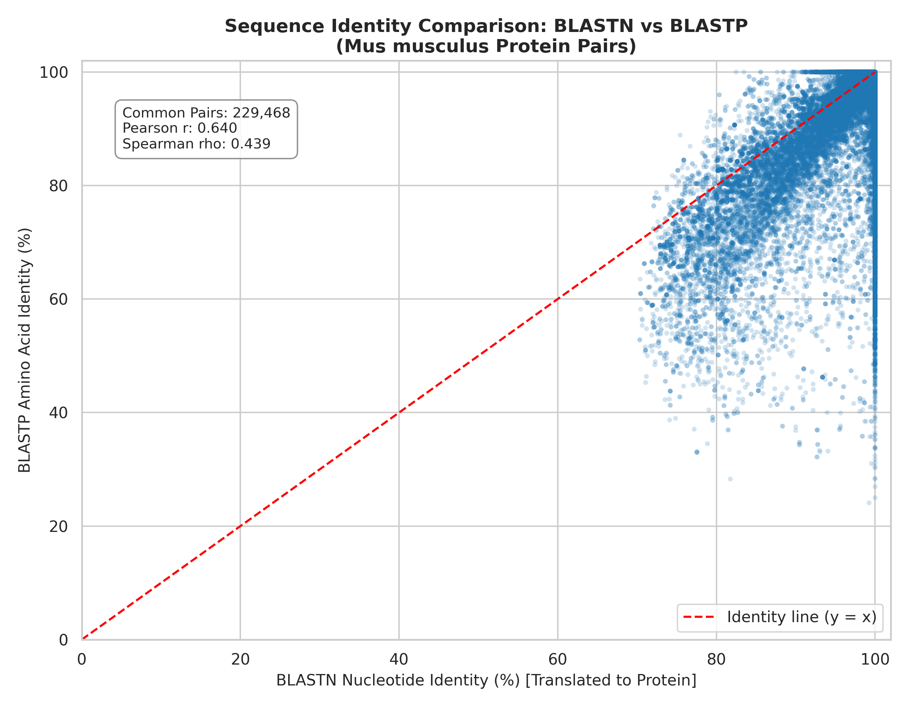

# Task 121: BLASTN vs BLASTP Similarity Comparison

## 1. Summary
Comparison between transcript-derived protein identity (BLASTN) and direct amino acid identity (BLASTP) in Mus musculus.

## 2. Pipeline
```text
       Mus_musculus.GRCm39.pep.all.fa
                       │
                       ▼  [ makeblastdb ]
            data/mouse_protein_db
                       │
                       ▼  [ blastp ]
         results/protein_blastp_self_results.tsv (197 MB)
                       │
                       ├─────────────────────────────────┐
                       ▼                                 ▼
       results/protein_blastp_self_results.tsv  results/protein_blastn_translated.tsv
          (BLASTP Protein Identity)               (BLASTN Translated Identity)
                       │                                 │
                       └────────────────┬────────────────┘
                                        ▼
                         [ compare_blastn_blastp.py ]
                                        │
                                        ▼
                             Common Pairs: 229,468
                    Pearson r: 0.6400 | Spearman rho: 0.4387
                                        │
                         ┌──────────────┴──────────────┐
                         ▼                             ▼
        results/blastn_vs_blastp_merged.tsv   results/blastn_vs_blastp_scatterplot.png
```

## 3. Key Metrics
- BLASTN Unique Pairs: 247,821
- BLASTP Unique Pairs: 1,551,771
- Common Overlapping Pairs: 229,468
- Pearson Correlation (r): 0.6400
- Spearman Correlation (rho): 0.4387

## 4. Result Graph

